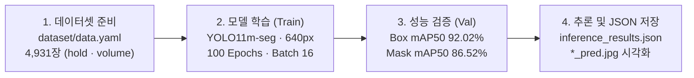

<div align="center">

# Climbing Hold & Volume Instance Segmentation (`01.climbing_instanceseg`)

**Ultralytics YOLO11m-seg training, validation, and polygon JSON extraction pipeline for indoor climbing walls.**

클라이밍 암벽 이미지에서 홀드(`hold`)와 볼륨(`volume`)의 세그멘테이션 마스크를 추출하는 `YOLO11m-seg` 학습·검증·추론 패키지입니다.

[**Quick Start**](#quick-start) · [**How It Works**](#how-it-works) · [**Capabilities**](#capabilities) · [**Showcases**](#showcases) · [**Reference**](#reference) · [**FAQ**](#faq)

```bash
python yolo_utiles.py
```

</div>

---

## Quick Start

### 1) 환경 구성 및 설치 (Setup)

```bash
pip install ultralytics opencv-python
```

### 2) 핵심 실행 — 학습·검증·추론 파이프라인 (Run)

```bash
cd 01.climbing_instanceseg
python yolo_utiles.py
```

### 3) 빠른 추론 테스트 (Control)

```bash
python test.py
```

---

## How It Works



---

## Capabilities

| 대상 / 기능 (Target / Feature) | 반환 결과 및 동작 (What It Returns) | 요구사항 및 트리거 (Requirements & Guide) |
| :--- | :--- | :--- |
| **`yolo_utiles.py`** | `train` ➔ `val` ➔ `predict` 순차 실행 및 `val_metrics.json`, `inference_results.json` 생성 | `dataset/data.yaml` 준비 후 `python yolo_utiles.py` 실행 |
| **`test.py`** | 학습 과정 없이 지정된 가중치(`best.pt`)로 단일/폴더 이미지 추론 및 `*_pred.jpg` 생성 | `model_path`, `source_path` 지정 후 `python test.py` 실행 |
| **`yolo_utiles.ipynb`** | Roboflow 데이터셋 다운로드 및 셀 단위 대화형 학습·시각화 | Jupyter 환경에서 실행 |

---

## Showcases

| 지표 (Metric) | `vr_1.0` | `vr_1.1` (Latest) | 변화량 (Delta) |
| :--- | :---: | :---: | :---: |
| **Box mAP50-95** | `0.6976` | **`0.7736`** | **+0.0760** |
| **Box mAP50** | `0.8568` | **`0.9202`** | **+0.0634** |
| **Mask mAP50-95** | `0.5504` | **`0.5840`** | **+0.0336** |
| **Mask mAP50** | `0.8149` | **`0.8652`** | **+0.0503** |
| **Precision** | `0.8834` | **`0.9047`** | **+0.0213** |
| **Recall** | `0.8081` | **`0.8751`** | **+0.0670** |

---

## Reference

| 산출물 경로 | 설명 |
| :--- | :--- |
| `runs/yolo11_climbing_seg_vr_1.1/train/weights/best.pt` | 최고 검증 성능 모델 가중치 |
| `runs/yolo11_climbing_seg_vr_1.1/train/results.csv` | 에폭별 학습 수치 로그 |
| `runs/yolo11_climbing_seg_vr_1.1/val/val_metrics.json` | 검증 성능 요약 JSON |
| `runs/yolo11_climbing_seg_vr_1.1/predict/inference_results.json` | 검출 객체별 클래스, 신뢰도, BBox, 폴리곤 좌표 JSON |

---

## FAQ

<details>
<summary><b>데이터셋 출처와 라이선스 정보는 무엇인가요?</b></summary>

Roboflow `Climbing Hold Detection` v29 (CC BY 4.0, 총 4,931장, `hold` 및 `volume` 2클래스) 데이터셋을 사용했으며, 상세 메타데이터는 `runs/yolo11_climbing_seg_vr_1.1/data_info/`에 기록되어 있습니다.
</details>
