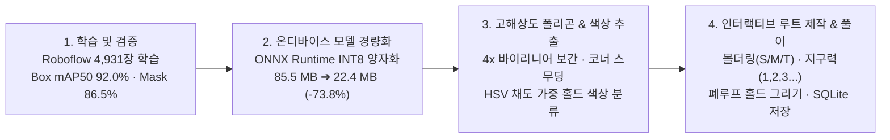

<div align="center">

# AutoHold-Route-HoldCraft

**AI/CV-based Indoor Climbing Hold & Volume Instance Segmentation Pipeline & On-Device Android Route-Setting App powered by Ultralytics YOLO11m-seg.**

실내 클라이밍 암벽 이미지에서 홀드(`hold`)와 볼륨(`volume`)의 정밀 다각형 마스크를 추출하는 비전 AI 파이프라인(`01.climbing_instanceseg`)과, 스마트폰으로 암벽을 촬영·업로드하여 온디바이스 순전파 및 터치 기반으로 나만의 볼더링·지구력 문제를 생성·저장·풀이하는 안드로이드 네이티브 앱(`android-app`) 통합 저장소입니다.

[](#quick-start)
[](#quick-start)
[-00FFFF)](#capabilities)
[](#showcases)
[](#showcases)
[](./LICENSE)
[-orange)](./THIRD_PARTY_NOTICES.md)

[**Quick Start**](#quick-start) · [**How It Works**](#how-it-works) · [**Capabilities**](#capabilities) · [**Showcases**](#showcases) · [**CLI & Artifacts**](#cli--artifacts) · [**FAQ**](#faq)

```bash
# Android 앱 빌드 및 기기 설치 (On-Device YOLO11m-seg INT8 추론)
cd android-app && ./gradlew assembleDebug && adb install -r app/build/outputs/apk/debug/app-debug.apk
```

</div>

---

## Quick Start

### 1) 환경 구성 및 설치 (Setup)

저장소를 클론하고 Python 학습·추론 환경 또는 Android 빌드 환경을 준비합니다.

```bash
# 1. 저장소 클론 및 이동
git clone https://github.com/yg-gulbi/AutoHold-Route-HoldCraft.git
cd AutoHold-Route-HoldCraft

# 2. (Python 파이프라인용) 필수 패키지 설치
pip install ultralytics opencv-python onnx onnxruntime
```

### 2) 핵심 실행 — Android 온디바이스 루트 메이커 앱 빌드·설치 (Run Mobile App)

사전 양자화된 `yolo11m_seg_climbing.onnx` (`22.4 MB`) 모델이 `android-app/app/src/main/assets/`에 내장되어 있어 별도 서버 없이 오프라인에서 즉시 작동합니다.

```bash
cd android-app
./gradlew testDebugUnitTest assembleDebug
adb install -r app/build/outputs/apk/debug/app-debug.apk
```

### 3) AI 파이프라인 제어 — 학습·검증·추론 실행 (Control Vision Pipeline)

```bash
cd 01.climbing_instanceseg

# 데이터셋 기반 학습(train) -> 검증(val) -> 추론(predict) 통합 실행
python yolo_utiles.py

# 사전 학습된 최고 성능 가중치(best.pt)로 단일/폴더 이미지 즉시 추론
python test.py
```

---

## How It Works

4,931장의 클라이밍 암벽 데이터셋으로 학습된 `YOLO11m-seg` 모델을 `INT8` 동적 양자화 ONNX로 변환하여 모바일 앱에 탑재하고, 서브픽셀 업샘플링 폴리곤과 대표 색상 추출을 거쳐 인터랙티브 루트 세팅 환경을 제공합니다.



---

## Capabilities

| 대상 / 기능 (Target / Feature) | 반환 결과 및 동작 (What It Returns) | 요구사항 및 트리거 (Requirements & Guide) |
| :--- | :--- | :--- |
| **온디바이스 홀드·볼륨 세그멘테이션** | 카메라 촬영 또는 갤러리 업로드 이미지에서 `hold`·`volume`의 BBox 및 고밀도 다각형 외곽선(최대 180점) 추출 | `android-app` 내 `HoldInferenceEngine` 및 `YoloSegDecoder` 실행 |
| **홀드 고유 색상 자동 인식 및 시각화** | 폴리곤 내부 픽셀의 HSV 채도 가중 평균을 계산하여 홀드 실제 색상 채움, 컬러 스와치, 한글 색상명(`빨강`, `파랑` 등) 표시 | `HoldColorExtractor.enrichWithColors` 자동 호출 |
| **듀얼 루트 세팅 모드 (볼더링 / 순서 지정)** | **모드 1(볼더링)**: `START`(초록)·`MOVE`(파랑)·`TOP`(빨강) 지정 / **모드 2(지구력)**: 터치 순서대로 `1, 2, 3...` 번호 부여 및 자동 재정렬 | 편집 화면 하단 모드 탭 전환 및 홀드 터치 |
| **수동 홀드 보정 툴박스 (폐루프 그리기 / 삭제 / 되돌리기)** | 미검출 홀드를 손가락으로 한 바퀴 둘러 그리면 **닫힌 폐루프(Closed Loop) 구간만** 윤곽선으로 생성(삐져나온 꼬리 자동 절단), 오검출 객체 터치 삭제 및 20단계 `되돌리기` 지원 | 편집 화면 하단 `+ 홀드 그리기` / `객체 삭제` 툴박스 선택 |
| **로컬 DB 영속화 및 수순 재생 풀이 (`SolverScreen`)** | 원본 암벽 이미지와 홀드 폴리곤, 선택된 루트를 기기 내부 SQLite(`holdcraft_problems.db`)에 영구 저장하고 `이전 수`/`다음 수` 단계별 풀이 지원 | 편집 완료 후 상단 `저장` 클릭 및 홈 목록에서 문제 선택 |
| **Python 학습·검증·JSON 직렬화 파이프라인** | `train` ➔ `val` ➔ `predict` 자동 수행 및 `inference_results.json`, `val_metrics.json` 산출물 기록 | `01.climbing_instanceseg/yolo_utiles.py` 실행 |

---

## Showcases

### 1. `vr_1.0` ➔ `vr_1.1` 파이프라인 고도화를 통한 전 지표 성능 도약
- **데이터셋**: Roboflow `Climbing Hold Detection` v29 (총 **4,931장**, `hold` / `volume` 2클래스, CC BY 4.0).
- **정량적 엔지니어링 지표**: `YOLO11m-seg` (imgsz `640`, batch `16`, epochs `100`, patience `20`) 학습을 통해 `vr_1.0` 대비 모든 정밀도·재현율 지표를 대폭 끌어올렸습니다.

| 평가 지표 (Metric) | `vr_1.0` (Baseline) | `vr_1.1` (Optimized) | 성능 향상폭 (Delta) |
| :--- | :---: | :---: | :---: |
| **Box mAP50** | `0.8568` (85.7%) | **`0.9202` (92.0%)** | **+6.34%p** |
| **Box mAP50-95** | `0.6976` (69.8%) | **`0.7736` (77.4%)** | **+7.60%p** |
| **Mask mAP50** | `0.8149` (81.5%) | **`0.8652` (86.5%)** | **+5.03%p** |
| **Mask mAP50-95** | `0.5504` (55.0%) | **`0.5840` (58.4%)** | **+3.36%p** |
| **Precision (정밀도)** | `0.8834` (88.3%) | **`0.9047` (90.5%)** | **+2.13%p** |
| **Recall (재현율)** | `0.8081` (80.8%) | **`0.8751` (87.5%)** | **+6.70%p** |

### 2. 안드로이드 온디바이스 추론을 위한 INT8 동적 양자화 및 고해상도 폴리곤 복원

| 최적화 항목 | 적용 전 (FP32 / 기본 격자) | 적용 후 (INT8 / 서브픽셀 보간) | 엔지니어링 효과 |
| :--- | :---: | :---: | :--- |
| **ONNX 모델 크기** | `85.5 MB` (`best.onnx`) | **`22.4 MB` (`yolo11m_seg_climbing.onnx`)** | 용량 **73.8% 절감**, 후보 검출 수 편차 `0` (`719개` 동일) |
| **폴리곤 마스크 해상도** | `160×160` 이진 격자 (계단 현상 발생) | **`4x` 바이리니어 보간 (`640×640`급) + Chaikin 스무딩** | 홀드 곡면 및 볼륨 모서리 정밀 밀착 (최대 180 정점) |
| **자유 그리기 윤곽선 보정** | 단순 시작-끝 직선 연결 | **선분 교차(`segmentIntersection`) 기반 폐루프 추출** | 드래그 시작/끝의 삐져나온 꼬리 선분 자동 제거 |

---

## CLI & Artifacts

### 디렉토리 및 주요 산출물 레퍼런스

| 경로 / 파일명 | 역할 및 설명 |
| :--- | :--- |
| `01.climbing_instanceseg/yolo_utiles.py` | 학습(`train`), 검증(`val`), 추론(`predict`), JSON 직렬화를 총괄하는 메인 파이프라인 스크립트 |
| `01.climbing_instanceseg/runs/yolo11_climbing_seg_vr_1.1/train/weights/best.pt` | 검증 mAP 기준 최고 성능을 기록한 `YOLO11m-seg` 체크포인트 가중치 |
| `android-app/app/src/main/assets/yolo11m_seg_climbing.onnx` | 안드로이드 앱에 탑재된 `INT8` 동적 양자화 세그멘테이션 모델 (`22.4 MB`) |
| `android-app/app/src/main/java/com/autohold/holdcraft/inference/HoldInferenceEngine.kt` | ONNX Runtime 기반 `640×640` 레터박스 전처리 및 온디바이스 추론 엔진 |
| `android-app/app/src/main/java/com/autohold/holdcraft/inference/YoloSegDecoder.kt` | NMS 후처리, `4x` 서브픽셀 바이리니어 마스크 업샘플링 및 폴리곤 외곽선 복원 디코더 |
| `android-app/app/src/main/java/com/autohold/holdcraft/inference/HoldColorExtractor.kt` | 홀드 다각형 내부 픽셀 채도 가중 샘플링 및 한글 색상명 분류기 |
| `android-app/app/src/main/java/com/autohold/holdcraft/ui/InteractiveWallCanvas.kt` | 줌/패닝, Ray-Casting 홀드 터치 판정, 폐루프 자유 그리기, 루트 오버레이 렌더링 캔버스 |
| `android-app/app/src/main/java/com/autohold/holdcraft/data/ProblemRepository.kt` | 생성된 문제(이미지 경로, 홀드 폴리곤, 루트 수순)를 관리하는 SQLite 로컬 저장소 |

---

## FAQ
냐옹
<details>
<summary><b>학습용 원본 데이터셋(dataset/)은 어디에 배치해야 하나요?</b></summary>

대용량 이미지 데이터셋은 `.gitignore`로 제외되어 있으므로, 재학습 시에는 `01.climbing_instanceseg/dataset/data.yaml` 경로에 맞추어 Roboflow 데이터셋을 배치해야 합니다. 실험에 사용된 데이터셋 메타데이터와 설정 스냅샷은 `runs/yolo11_climbing_seg_vr_1.1/data_info/`에 보존되어 있습니다.
</details>

<details>
<summary><b>모델이 놓친 홀드를 추가하거나 잘못 인식한 홀드를 지우려면 어떻게 하나요?</b></summary>

앱 편집 화면 하단의 **편집 도구 툴박스**에서 **`+ 홀드 그리기`**를 선택한 뒤 홀드 둘레를 한 바퀴 감싸 폐루프(Closed Loop)가 되도록 그리면, 교차점 바깥의 불필요한 꼬리는 잘려 나가고 닫힌 윤곽선과 홀드 색상이 자동 추출되어 추가됩니다. 반대로 **`객체 삭제`**를 선택하고 오검출된 홀드를 터치하면 즉시 삭제되며, 상단 **`되돌리기`** 버튼으로 최대 20단계까지 복구할 수 있습니다.
</details>

<details>
<summary><b>라이선스(License) 및 데이터셋 출처 표기는 어떻게 되나요?</b></summary>

- **소스 코드 및 학습된 모델 가중치 (`best.pt`, `yolo11m_seg_climbing.onnx`)**: Ultralytics YOLO11 기반으로 학습되었으므로 [GNU Affero General Public License v3.0 (`AGPL-3.0`)](./LICENSE)이 적용됩니다.
- **학습 데이터셋**: Roboflow `Climbing Hold Detection` v29 데이터셋을 사용했으며 [Creative Commons Attribution 4.0 (`CC BY 4.0`)](./THIRD_PARTY_NOTICES.md) 라이선스를 따릅니다.
</details>
