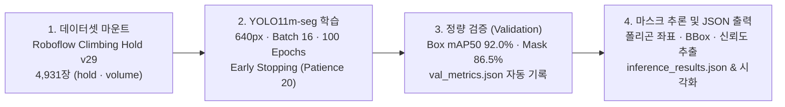

<div align="center">

# AutoHold-Route-HoldCraft

**AI/CV-based Indoor Climbing Hold & Volume Instance Segmentation Pipeline powered by Ultralytics YOLO11m-seg.**

실내 클라이밍 암벽 이미지에서 홀드(`hold`)와 볼륨(`volume`)의 바운딩 박스 및 픽셀 단위 폴리곤 마스크를 정밀 추출하여 루트 세팅 및 지구력(Endurance) 문제 생성의 기반 데이터를 구축하는 비전 AI 파이프라인입니다.

[](#quick-start)
[](#capabilities)
[](#showcases)
[](#showcases)
[-orange)](#how-it-works)

[**Quick Start**](#quick-start) · [**How It Works**](#how-it-works) · [**Capabilities**](#capabilities) · [**Showcases**](#showcases) · [**CLI & Artifacts**](#cli--artifacts) · [**FAQ**](#faq)

```bash
python 01.climbing_instanceseg/yolo_utiles.py
```

</div>

---

## Quick Start

### 1) 환경 구성 및 설치 (Setup)

저장소를 클론하고 Ultralytics YOLO11 및 OpenCV 패키지를 설치합니다.

```bash
# 1. 저장소 클론 및 작업 폴더 이동
git clone https://github.com/yg-gulbi/AutoHold-Route-HoldCraft.git
cd AutoHold-Route-HoldCraft/01.climbing_instanceseg

# 2. 필수 패키지 설치
pip install ultralytics opencv-python
```

### 2) 핵심 실행 — 학습·검증·추론 통합 파이프라인 (Run)

`yolo_utiles.py`를 실행하면 모델 가중치와 추론 대상 경로를 입력받아 `train` ➔ `val` ➔ `predict` 및 폴리곤 JSON 추출을 순차 실행합니다.

```bash
# 데이터셋(01.climbing_instanceseg/dataset/data.yaml) 기반 통합 파이프라인 실행
python yolo_utiles.py
```

### 3) 단일/개인 이미지 빠른 추론 제어 (Control)

재학습 없이 사전 학습된 최고 성능 가중치(`runs/yolo11_climbing_seg_vr_1.1/train/weights/best.pt`)로 암벽 이미지를 즉시 추론하고 마스크 시각화를 생성합니다.

```bash
# 저장된 best.pt 가중치로 테스트 이미지 세그멘테이션 추론 실행
python test.py
```

---

## How It Works

4,931장의 클라이밍 암벽 데이터셋을 기반으로 `YOLO11m-seg` 모델을 학습하고, 검출된 각 홀드·볼륨의 다각형 윤곽선 좌표를 구조화된 JSON(`inference_results.json`)으로 변환합니다.



---

## Capabilities

| 대상 / 기능 (Target / Feature) | 반환 결과 및 동작 (What It Returns) | 요구사항 및 트리거 (Requirements & Guide) |
| :--- | :--- | :--- |
| **홀드·볼륨 인스턴스 세그멘테이션** | 암벽 이미지 내 개별 `hold` 및 대형 `volume`의 클래스, 신뢰도(Confidence), BBox, 다각형 마스크(`mask polygon`) 좌표 반환 | `01.climbing_instanceseg/yolo_utiles.py`의 `YOLOSegmentPipeline` 실행 |
| **구조화된 JSON 산출물 생성** | 후속 루트 생성기 및 인터랙티브 터치 UI에서 즉시 파싱 가능한 `predict/inference_results.json` 및 `val/val_metrics.json` 자동 저장 | `yolo_utiles.py` 추론 단계 완료 시 `runs/<exp_name>/predict/` 하위에 자동 기록 |
| **원클릭 시각화 프리뷰 (`test.py`)** | 원본 암벽 이미지 위에 검출된 홀드 외곽선과 클래스를 오버레이한 `*_pred.jpg` 결과 이미지 즉시 생성 | `01.climbing_instanceseg/test.py` 실행 (`test/` 폴더 내 샘플 및 결과 수록) |
| **실험 버전별 아카이빙 (`runs/`)** | `vr_1.0` 및 `vr_1.1` 실험의 최고 가중치(`best.pt`), 에폭별 로그(`results.csv`), 성능 곡선(`results.png`) 보존 | `01.climbing_instanceseg/runs/yolo11_climbing_seg_vr_1.1/` 디렉토리 참조 |

---

## Showcases

### 1. `vr_1.0` ➔ `vr_1.1` 파이프라인 고도화를 통한 전 지표 성능 도약
- **데이터셋**: Roboflow `Climbing Hold Detection` v29 (총 **4,931장**, `hold` / `volume` 2클래스, CC BY 4.0).
- **정량적 엔지니어링 지표**: `YOLO11m-seg` (imgsz `640`, batch `16`, epochs `100`, patience `20`) 학습을 통해 `vr_1.0` 대비 모든 정밀도·재현율 지표를 대폭 끌어올렸습니다.

| 평가 지표 (Metric) | `vr_1.0` (Baseline) | `vr_1.1` (Optimized) | 성능 향상폭 (Delta) |
| :--- | :---: | :---: | :---: |
| **Box mAP50** | `0.8568` (85.7%) | **`0.9202` (92.0%)** | **+6.34%p** |
| **Box mAP50-95** | `0.6976` (69.8%) | **`0.7736` (77.4%)** | **+7.60%p** |
| **Mask mAP50** | `0.8149` (81.5%) | **`0.8652` (86.5%)** | **+5.03%p** |
| **Mask mAP50-95** | `0.5504` (55.0%) | **`0.5840` (58.4%)** | **+3.36%p** |
| **Precision (정밀도)** | `0.8834` (88.3%) | **`0.9047` (90.5%)** | **+2.13%p** |
| **Recall (재현율)** | `0.8081` (80.8%) | **`0.8751` (87.5%)** | **+6.70%p** |

---

## CLI & Artifacts

### 디렉토리 및 주요 산출물 레퍼런스

| 경로 / 파일명 | 역할 및 설명 |
| :--- | :--- |
| `01.climbing_instanceseg/yolo_utiles.py` | 학습(`train`), 검증(`val`), 추론(`predict`), JSON 직렬화를 총괄하는 메인 파이프라인 스크립트 |
| `01.climbing_instanceseg/yolo_utiles.ipynb` | Roboflow 데이터셋 다운로드 및 대화형 실험을 위한 Jupyter 노트북 |
| `01.climbing_instanceseg/test.py` | 학습된 가중치로 단일/폴더 이미지를 빠르게 추론하고 `*_pred.jpg`를 생성하는 스크립트 |
| `runs/yolo11_climbing_seg_vr_1.1/train/weights/best.pt` | 검증 mAP 기준 최고 성능을 기록한 `YOLO11m-seg` 체크포인트 가중치 |
| `runs/yolo11_climbing_seg_vr_1.1/val/val_metrics.json` | Box/Mask mAP, Precision, Recall 최종 검증 수치 요약 JSON |
| `runs/yolo11_climbing_seg_vr_1.1/predict/inference_results.json` | 이미지별 검출된 홀드·볼륨의 클래스, BBox, 폴리곤 마스크 좌표 데이터 |

### 기본 하이퍼파라미터 스펙

| 파라미터 | 설정값 | 비고 |
| :--- | :---: | :--- |
| `Model` | `YOLO11m-seg` | Medium 규모 인스턴스 세그멘테이션 백본 |
| `Epochs` / `Patience` | `100` / `20` | 20 에폭 연속 미개선 시 조기 종료(Early Stopping) |
| `Image Size` / `Batch` | `640` / `16` | GPU(`device=0`) 기준 표준 해상도 및 배치 크기 |

---

## FAQ

<details>
<summary><b>학습용 원본 데이터셋(dataset/)은 어디에 배치해야 하나요?</b></summary>

대용량 이미지 데이터셋은 `.gitignore`로 제외되어 있으므로, 재학습 시에는 `01.climbing_instanceseg/dataset/data.yaml` 경로에 맞추어 Roboflow 데이터셋을 배치해야 합니다. 실험에 사용된 데이터셋 메타데이터와 설정 스냅샷은 `runs/yolo11_climbing_seg_vr_1.1/data_info/`에 보존되어 있습니다.
</details>

<details>
<summary><b>GPU가 없는 CPU 환경에서도 추론이나 학습을 실행할 수 있나요?</b></summary>

가능합니다. `yolo_utiles.py` 또는 `test.py` 내 추론/학습 호출부의 `device` 인자를 `0` 대신 `'cpu'`로 변경하면 CPU 환경에서도 동일하게 동작합니다.
</details>

<details>
<summary><b>test.py로 새로운 암벽 사진을 테스트하려면 어떻게 하나요?</b></summary>

`01.climbing_instanceseg/test.py` 내부의 `model_path`를 `runs/yolo11_climbing_seg_vr_1.1/train/weights/best.pt`로 지정하고, `source_path`에 테스트할 이미지 또는 디렉토리 상대 경로를 입력한 뒤 실행하면 같은 폴더에 `_pred_...jpg` 결과물이 생성됩니다.
</details>
